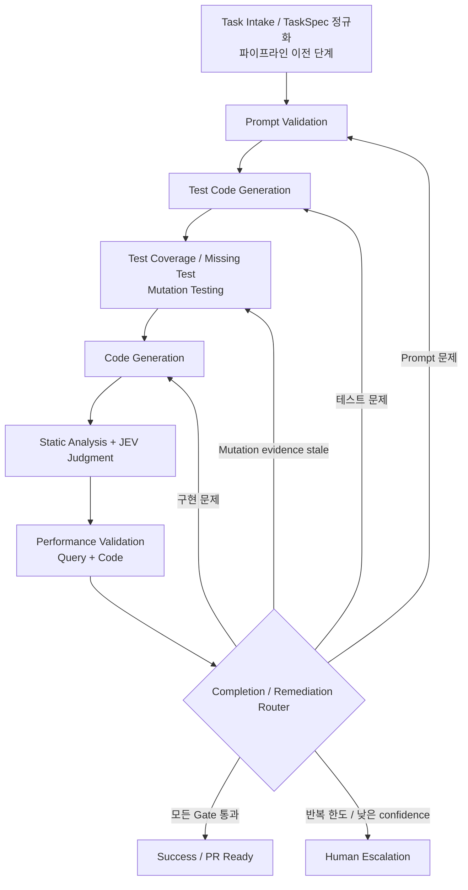
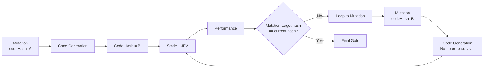
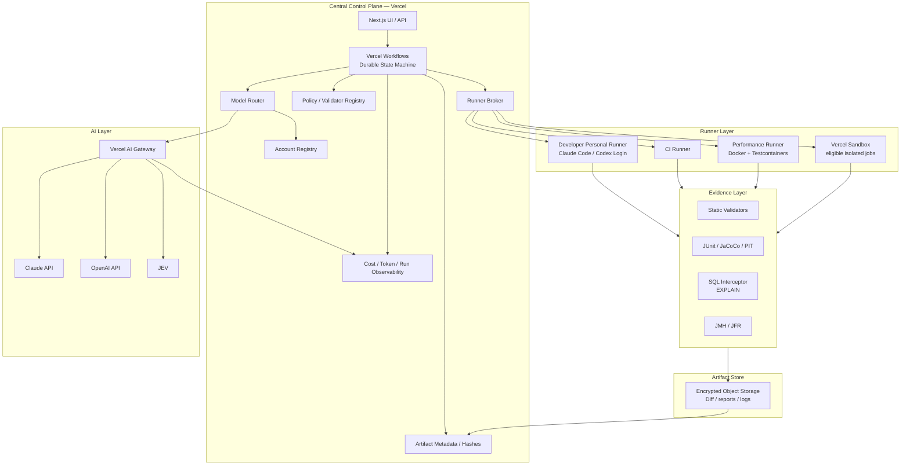
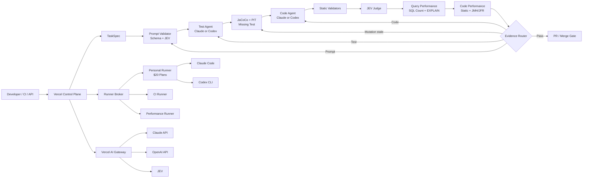

# 중앙집중형 AI Agent 개발 자동화 워크플로우 설계 보고서

## Executive Summary

### 결론

현재 목표에는 **“하나의 거대한 코딩 Agent”보다 중앙 Control Plane + 독립 Runner + 결정론적 Validator + LLM Generator + JEV Judge를 조합한 Software Factory 형태**가 가장 적합하다. 최근 Vercel은 실제 내부 소프트웨어 팩토리에서 버그 재현, 수정, PR 검토, 기능 분석·구현 등을 하나의 만능 Agent가 아니라 역할별 Agent로 분리해 운영하는 패턴을 공개했고, 자체 `eve` 프레임워크에서도 durable workflow, sandboxed compute, human approval, subagent, eval을 핵심 구성요소로 두고 있다. OpenAI 역시 장시간 코딩 Agent를 잘 작동시키려면 거대한 지시 한 번보다 작업을 작은 단위로 나누고, 개발 도구·로그·테스트 결과를 Agent가 읽을 수 있게 만들며, 구현 후 별도의 리뷰 루프를 돌리는 “harness engineering”을 강조한다. Anthropic도 장시간 Agent에서 planner–generator–evaluator와 세션 사이에 유지되는 구조화된 artifact를 권장한다. citeturn5view0turn5view1turn5view2turn5view3

따라서 추천 구조는 다음과 같다.

> **Vercel = 중앙 Control Plane / Durable Orchestrator / AI Gateway / UI**  
> **Runner = 실제 Git checkout, Gradle/Maven, Java, Docker/Testcontainers, PIT, 정적 분석, 성능 테스트 실행 환경**  
> **Claude/Codex = 요구사항 정제·테스트·코드 작성처럼 생성 능력이 필요한 부분**  
> **JEV = “맞다/아니다/어디로 되돌아갈 것인가”처럼 매우 자주 발생하는 저비용 의미 판단**  
> **기존 정적 분석기 + PIT + JaCoCo + ArchUnit + DB instrumentation + JMH/JFR = 사실을 만들어내는 Evidence Layer**

특히 **JEV에게 정적 분석기나 profiler 역할을 시키면 안 된다.** Jev는 텍스트를 받아 typed decision과 probability/confidence를 빠르게 반환하도록 설계된 System One 모델이며, 일반 LLM처럼 코드를 작성하거나 긴 설명을 만드는 모델이 아니다. 현재 Jev 1.13은 입력 100만 토큰당 $0.042, 출력 비용 없음이며 64K 요청 컨텍스트를 제공한다. TypeSafe 역시 제어 흐름과 side effect는 코드가 담당하고, Jev에는 좁고 명확한 질문을 주며 confidence가 낮으면 상위 모델이나 사람에게 escalation하는 구조를 권장한다. citeturn1search0turn1search16turn1search19turn16search4

가장 중요한 설계 원칙은 **“LLM이 성능 문제를 추측하게 하지 말고, 도구가 증거를 수집하고 JEV/LLM은 그 증거를 판정하게 한다”**이다. 예를 들어 “MyBatis니까 느리다”, “QueryDSL로 바꾸면 빨라진다”는 룰을 만들면 안 된다. MyBatis는 공식적으로 `Executor.query`, `StatementHandler.query`, `ResultSetHandler` 등을 plugin으로 intercept할 수 있으므로 실제 SQL fingerprint, 호출 횟수, 중복 횟수, 반환 row 수와 시간을 계측할 수 있다. PostgreSQL `EXPLAIN ANALYZE`는 실제 query를 수행하고 각 plan node의 actual time과 rows를 보여준다. 따라서 **현재 구현과 후보 구현의 SQL 개수·SQL shape·row 수·실행계획을 비교한 뒤 바꿀지 판단**해야 한다. citeturn18search0turn18search7

사용자가 요구한 단계 순서는 그대로 유지할 수 있다.



다만 이 순서에는 한 가지 중요한 기술적 문제가 있다. **신규 기능의 mutation testing은 코드가 존재하기 전에 최종적으로 수행할 수 없다.** PIT는 production code에 mutation을 주입하여 테스트가 이를 잡아내는지 보는 도구이기 때문이다. citeturn18search9turn18search1

이를 단계 순서를 변경하지 않고 해결하려면 모든 분석 결과에 `targetCodeHash`를 붙이면 된다. 첫 번째 Stage M에서는 기존 코드에 대해 mutation을 수행하고, Stage C에서 코드가 바뀌면 기존 mutation report를 `STALE`로 만든다. Performance Validation까지 끝난 Completion Router가 `mutationReport.targetCodeHash != currentCodeHash`를 발견하면 **M으로 되돌아간다.** 새 코드에 대해 mutation이 다시 수행된 뒤 Code Generation은 수정할 것이 없으면 no-op으로 지나간다. 이렇게 하면 요구한 순서를 어기지 않으면서 최종 merge 직전 mutation evidence가 현재 코드와 일치한다.

또 하나의 핵심 결론은 **현재 사용 중인 Claude $20 구독과 ChatGPT $20 구독을 중앙 서버의 API credential처럼 취급해서는 안 된다는 것**이다. OpenAI는 ChatGPT 구독과 API billing이 별개라고 명시하며, programmatic CI/CD에서는 API key 사용을 권장한다. Codex에는 ChatGPT 계정 인증을 CI에서 유지하는 고급 방법도 있지만 공식 문서가 “automation의 올바른 방법은 API key”라고 명시한다. ChatGPT Business/Enterprise에는 programmatic Codex access token이 있지만 현재 Plus 대상 기능은 아니다. citeturn14search0turn14search1turn14search4turn14search10

Claude 쪽은 GitHub Actions에서 Pro/Max 등의 subscription OAuth token을 사용할 수 있지만, 조직 전체 reusable workflow에서는 개인 구독에 묶인 OAuth보다 API key를 권장하고 있으며, 더 나아가 GitHub OIDC와 Anthropic service account를 이용한 workload identity federation도 지원한다. citeturn13search7

그래서 **두 가지 실행 모드**를 동시에 지원하는 것이 좋다.

| 모드 | 용도 | 인증 | 비용 모델 | 추천도 |
|---|---|---|---|---|
| **Personal Runner** | 현재 $20 구독 최대 활용 | 각 개발자 PC/runner의 공식 Claude Code·Codex 로그인 | subscription allowance | 개인/초기 MVP에 **강력 추천** |
| **Central API Service** | 24/7, 팀 공유, CI/CD | Vercel AI Gateway/BYOK/API service account | API 사용량 | 운영 환경에 **강력 추천** |
| 중앙에서 개인 OAuth token pooling | 여러 $20 계정을 서버가 공유 | 개인 session/OAuth 수집 | 불명확 | **비추천** |
| Hybrid | 평시 personal runner, CI/overflow만 API | 둘 다 | 혼합 | **최종 권장** |

OpenAI는 API key 공유를 권장하지 않고 project/service account 및 별도 key를 제공하며, Anthropic 역시 조직형 자동화에 API key/service account/workload identity 방식을 제공한다. 따라서 “multiple LLM accounts”는 **credential pooling**이 아니라 `ModelAccountRegistry`가 권한을 가진 account/provider를 선택하도록 설계해야 한다. citeturn14search2turn14search5turn14search8turn13search7

Vercel은 이 구조의 중앙 계층으로 상당히 잘 맞는다. Workflows는 실패 후 retry하고 crash/deploy 후에도 상태를 복구하는 durable multi-step workflow를 제공하며, AI Gateway는 provider routing, fallback, token/cost/latency 기록, budget을 제공한다. Gateway의 token 가격에는 platform markup이 없으며 BYOK도 지원한다. Sandbox는 agent-generated code를 production system에서 분리해 실행하도록 설계되어 있다. citeturn13search0turn13search2turn16search8turn16search10

다만 **Java/Testcontainers/PIT/성능 측정은 Vercel에 완전히 종속시키지 않는 것이 좋다.** 중앙 시스템은 `RunnerProvider` 인터페이스만 알고, 실행 환경은 Vercel Sandbox, 개발자 PC, GitHub/self-hosted runner, VM/Kubernetes 중 프로젝트 상황에 맞춰 선택하게 만든다. 특히 Testcontainers는 실제 DB를 container로 실행해 반복 가능한 알려진 상태를 만드는 것이 장점이므로, DB/Docker가 필요한 performance runner는 해당 실행 조건이 명확히 보장되는 별도 Runner Pool을 두는 것이 안전하다. citeturn20search0turn20search19

---

## 전제와 최근 AI 개발 자동화 패턴

### 명시적 전제

이 보고서의 구체적인 validator 설계는 다음을 기본 가정으로 한다.

| 항목 | 가정 |
|---|---|
| 주요 Backend | Java + Spring Boot |
| DB | PostgreSQL 계열을 예시로 사용하되 Adapter 구조 |
| Persistence | JPA/QueryDSL 및 MyBatis가 함께 존재할 수 있음 |
| Build | Gradle 또는 Maven |
| Test | JUnit 5 기반 |
| 기존 자산 | 아키텍처/컨벤션 정적 분석기 일부 존재 |
| 중앙 시스템 | Vercel에 Control Plane을 둘 수 있음 |
| Git | GitHub 또는 이에 준하는 Git remote |
| 목표 | 완전 자동화하되 merge까지 무조건 무인으로 만들 필요는 없음 |
| 공수 | 기존 validator 재사용을 전제로 한 **engineer-day 추정치**이며 견적이 아님 |

### 잘 쓰는 조직들이 수렴하는 구조

Vercel이 공개한 AI SDK software factory는 bug reproduction, bug fixing, PR review, feature analysis/implementation을 역할별로 나누고 있다. Vercel의 `eve` 역시 agent를 durable workflow로 실행하고 checkpoint, pause/resume, sandbox, human approval, eval을 핵심 개념으로 둔다. citeturn5view0turn5view3

OpenAI가 공개한 자체 agent-first engineering 사례에서도 단순히 “Agent에게 긴 요구사항을 넣는다”가 아니라, repository 구조와 명령을 agent가 쉽게 이해하도록 환경을 정리하고, 표준 개발 도구를 직접 실행하게 하며, 구현 후 특정 리뷰 agent를 추가로 돌리는 방식이 사용된다. 또한 거대한 설명서를 context에 통째로 넣기보다 Agent에게 코드베이스의 **map**을 제공하는 것이 핵심이라고 설명한다. citeturn5view1

Vercel도 Next.js Agent eval에서 방대한 documentation을 계속 context에 넣는 대신 압축된 정적 index를 제공하는 방식을 실험했으며, 해당 특정 benchmark에서는 약 40 KB 문서를 약 8 KB index로 줄이고도 성능을 유지했다고 공개했다. 이 수치를 일반화할 수는 없지만, **repo map + 필요할 때 원문 retrieval**이라는 방향은 토큰 절감에 매우 적합하다. citeturn5view4

Anthropic의 장시간 agent 연구도 작업을 작은 단위로 나누고 이전 세션이 남긴 구조화된 artifact를 다음 세션에서 이용하는 접근을 강조한다. 즉 세 회사의 공개 사례를 종합하면 다음과 같은 형태로 수렴한다. citeturn5view2

```text
LLM 자체를 똑똑하게 만드는 것
              ↓
       이것만으로는 부족
              ↓
Task Contract
+ Deterministic Tools
+ Small Context
+ Isolated Execution
+ Evidence Artifacts
+ Specialized Agents
+ Durable Retry
+ Evaluation
```

이 구조에서 사용자가 이미 만들고 있는 **멱등성, transaction self-invocation, test 검증, mutation, architecture/convention validator**는 매우 좋은 출발점이다. 예를 들어 Spring은 기본 proxy transaction mode에서 같은 객체 내부의 self-invocation이 실제 transactional interception을 일으키지 않는다고 공식적으로 명시한다. 이런 문제는 JEV가 추측할 필요 없이 AST/bytecode 규칙으로 확정적으로 찾아내고, JEV는 “현재 변경에서 실제 위험성이 어느 정도인지”만 판단하게 하는 것이 더 정확하다. citeturn19search1

### LLM과 JEV의 역할 분리

| 역할 | Claude/Codex | JEV | Deterministic Tool |
|---|---:|---:|---:|
| 요구사항 재작성 | ◎ | × | Schema 검증 |
| Test 작성 | ◎ | × | Compile/Test |
| Code 작성 | ◎ | × | Compile |
| 누락 테스트 후보 생성 | ◎ | ○ | JaCoCo/PIT |
| 규칙 위반 검색 | △ | △ | **◎** |
| 규칙의 의미적 예외 판단 | ○ | **◎** | △ |
| SQL 횟수 측정 | × | × | **◎** |
| EXPLAIN 분석용 데이터 생성 | × | × | **◎** |
| 성능 evidence 최종 분류 | ○ | **◎** | threshold |
| 루프 목적지 결정 | △ | **◎** | hard rule |
| 복잡한 모호성 해결 | **◎** | △ | × |

Jev는 text-only이고 typed decisions/probabilities에 특화되어 있으며, TypeSafe도 복잡한 수치 계산이나 여러 단계의 간접 추론보다 좁은 decision 문제로 사용하도록 안내한다. 따라서 `EXPLAIN`의 50개 숫자를 던지고 “이 쿼리가 느린가?”를 묻기보다는 프로그램이 먼저 `sequentialScan=true`, `actualRows=48321`, `expectedRows=51`, `queryCountGrowth=linear`, `duplicateFingerprintCount=50`처럼 evidence를 요약한 다음 JEV가 정책 위반 여부를 판단하게 하는 편이 맞다. citeturn1search7turn1search19turn16search4

---

## 권장 워크플로우와 중앙 아키텍처

### TaskSpec으로 모든 입력을 통일

완전한 요구사항 문서가 들어오든,

> “주문 조회 기능 하나 추가해줘”

가 들어오든,

> “이 서비스 리팩토링해”

가 들어오든,

> “이 PR 성능 좀 개선해”

가 들어오든 내부적으로는 동일한 `TaskSpec`으로 변환해야 한다.

```yaml
task:
  id: TASK-2026-001
  type: FEATURE # BUG_FIX | REFACTOR | PERFORMANCE | MAINTENANCE

goal:
  - "주문 목록 API에 고객 등급을 표시한다"

nonGoals:
  - "주문 저장 로직은 변경하지 않는다"

acceptanceCriteria:
  - id: AC-01
    text: "각 주문에 customerGrade가 반환된다"
  - id: AC-02
    text: "주문이 50개여도 고객 조회 SQL이 주문 개수만큼 증가하지 않는다"

invariants:
  - "기존 API field는 삭제하지 않는다"
  - "transaction boundary를 변경하지 않는다"

scope:
  files: []
  symbols: []
  allowedModules:
    - order

validators:
  architecture: OPTIONAL
  convention: OPTIONAL
  mutation: REQUIRED
  queryPerformance: REQUIRED
  codePerformance: AUTO

performanceBudget:
  maxSelectQueries: 3
  forbidLinearQueryGrowth: true

unknowns: []

source:
  kind: AD_HOC
```

**전체 명세가 있는 경우에는 TaskSpec을 추출하고, ad-hoc request라면 빠진 부분만 inferred/default/unknown으로 표시한다.** 중요한 것은 LLM이 모르는 내용을 조용히 만들어내지 못하게 `unknowns`를 명시적인 데이터 구조로 만드는 것이다.

TaskSpec 정규화는 사용자가 지정한 pipeline 이전의 intake 단계다. 따라서 실제 실행 순서는 요청대로 **Prompt Validation부터 시작한다.**

### 단계별 계약

| 단계 | 입력 | 출력 | LLM 필요 여부 | 실패 시 |
|---|---|---|---|---|
| Prompt Validation | TaskSpec | PromptContract | JEV + 필요 시 LLM | Prompt |
| Test Generation | PromptContract + 관련 코드 | TestDiff + RequirementTestMap | LLM | Test |
| Coverage / Missing / Mutation | TestDiff + baseline | CoverageEvidence + MutationEvidence | 대부분 Tool, JEV 보조 | Test |
| Code Generation | Accepted Test + TaskSpec | CodeDiff | LLM | Code |
| Static + JEV | CodeDiff + findings | StaticEvidence + JudgeVerdict | Tool + JEV | Prompt/Test/Code |
| Performance | runnable code | PerfEvidence | Tool + JEV | Test/Code/Prompt |
| Router | 모든 evidence hash | RemediationRoute | JEV + hard rule | 해당 stage |

JaCoCo는 instruction/line/branch와 cyclomatic complexity 등의 coverage counter를 제공하고, PIT는 production code에 mutation을 만들고 테스트가 fault를 탐지하는지 평가하며 incremental 분석도 지원한다. 따라서 Stage M은 raw line coverage 하나가 아니라 requirement mapping + branch coverage + mutation result를 합쳐야 한다. citeturn19search0turn19search12turn18search1

### Mutation evidence freshness

앞서 설명한 순서 문제를 다음처럼 해결한다.



이 방식의 장점은 final report의 모든 artifact가 어떤 source revision에서 만들어진 것인지 검증할 수 있다는 점이다.

권장 artifact envelope은 다음 정도면 충분하다.

```json
{
  "runId": "run_...",
  "stage": "PERFORMANCE",
  "sourceHash": "git-sha...",
  "inputArtifactHashes": ["..."],
  "policyVersion": "2026-10-01",
  "toolVersion": "perf-validator-0.4.1",
  "status": "FAIL",
  "findings": [],
  "createdAt": "..."
}
```

`runId + stage + sourceHash + policyVersion`을 idempotency key로 사용하면 동일 입력에 대한 재시도에서 비싼 LLM/성능 검증을 불필요하게 다시 실행하는 것도 피할 수 있다.

### 중앙 아키텍처



Vercel Workflows는 각 workflow input/output을 event log에 기록하고 crash나 deployment 후 replay하여 진행 상태를 복원한다. 그래서 **소스 전체, SQL parameter, secret을 Workflow state 자체에 넣지 않고 encrypted artifact storage의 ID/hash만 전달하는 방식**을 권장한다. citeturn13search4

AI Gateway는 한 endpoint에서 provider routing과 fallback을 지원하고 provider, latency, token usage, cost, routing attempt를 기록하며 team/project/API key/member 단위 budget을 둘 수 있다. Token 가격 자체에 Vercel markup도 없다. 중앙 Model Router를 직접 처음부터 모두 구현하는 것보다 좋은 출발점이다. citeturn16search2turn16search5turn16search8turn16search10

Jev도 현재 Vercel AI Gateway에서 사용할 수 있고 AI SDK의 evaluation 계열과 결합할 수 있으므로, JEV 전용 Adapter를 만들되 transport는 직접 TypeSafe API 또는 Gateway 중 선택 가능하도록 하는 것이 좋다. citeturn1search5turn1search13

### 어느 환경에서나 붙는 Runner

중앙 시스템의 portability를 만드는 핵심은 Agent 자체가 아니라 **Runner Protocol**이다.

```text
POST /runners/register
    ↓
Runner가 capabilities 보고

{
  "os": "linux",
  "java": ["21"],
  "docker": true,
  "database": ["postgresql"],
  "tools": ["pitest", "jacoco", "jmh"],
  "llmAuth": ["claude-subscription", "chatgpt-subscription"]
}

    ↓

Runner가 outbound pull
GET /jobs/lease

    ↓

short-lived job token 발급

    ↓

git worktree / sandbox 생성
    ↓
tool 수행
    ↓
artifact upload
    ↓
workspace 폐기
```

이렇게 하면 사무실 PC, 개발 노트북, GitHub Runner, EC2, Kubernetes, 사내 서버가 모두 똑같은 중앙 workflow에 붙을 수 있다.

또 **중앙 서버가 사용자의 Claude/ChatGPT session token을 보유할 이유가 없다.** Personal Runner는 설치된 공식 Claude Code/Codex binary가 각 사용자의 인증을 직접 사용하고 중앙에는 `capability=claude_subscription`만 알려주도록 한다. Codex CLI는 로컬 repository를 읽고 수정하고 설치된 도구를 실행할 수 있으며 script/CI에서 `codex exec` 형태로 사용할 수 있다. citeturn17search6

---

## 검증기와 성능 검증 설계

### Validator Registry

검증기를 하나의 interface로 통일하면 architecture/convention validator를 켜고 끄는 것도 쉬워진다.

```typescript
interface Validator {
  id: string;
  supports(ctx: RunContext): boolean;
  validate(ctx: RunContext): Promise<ValidationResult>;
}

interface ValidationResult {
  status: "PASS" | "FAIL" | "WARN" | "SKIP";
  findings: Finding[];
  evidenceRefs: string[];
  sourceHash: string;
}
```

권장 구성은 다음과 같다.

| 영역 | 도구/방법 | 판정 방식 | 기본 |
|---|---|---|---|
| Compile | javac/Gradle/Maven | deterministic | 필수 |
| Unit/Integration | JUnit | deterministic | 필수 |
| Coverage | JaCoCo | threshold + changed code | 필수 |
| Mutation | PIT | surviving mutant | 필수 |
| Architecture | 기존 분석기 + ArchUnit | deterministic | 선택 |
| Convention | 기존 분석기 / PMD | deterministic | 선택 |
| Bug pattern | SpotBugs | deterministic | 권장 |
| Custom AST | PMD custom Java/XPath | deterministic | 권장 |
| Spring transaction | custom AST/bytecode | deterministic | 필수 |
| Idempotency | 기존 custom validator | hybrid | 필수 |
| Query | MyBatis/JDBC instrumentation | runtime evidence | 권장 |
| DB plan | EXPLAIN | runtime evidence | changed hot query |
| Code perf | static candidate + JMH/JFR | evidence | 조건부 |
| Semantic decision | JEV | probabilistic | 필수 |

ArchUnit은 Java bytecode를 분석해 package/class dependency, layer, cycle 등을 검사할 수 있으므로 architecture validator를 직접 모두 구현하기보다 기존 분석기에 결합하기 좋다. citeturn18search2turn18search6

PMD는 Java/XPath custom rule을 작성할 수 있고 자체 ruleset을 만들 수 있으므로 “mapper 호출이 loop body 내부에서 발생”, “특정 계층에서 특정 API 호출 금지”처럼 프로젝트 고유 규칙을 만드는 기반으로 적합하다. SpotBugs에는 `PERFORMANCE` category와 잘못된 map iteration, 불필요한 객체 생성 등 여러 bug pattern이 존재한다. citeturn19search2turn19search6turn19search7turn19search15

### Profile로 validator를 선택

Architecture 및 convention을 매번 강제할 필요는 없다.

```yaml
profiles:

  fast:
    compile: true
    unitTest: true
    staticChangedOnly: true
    architecture: false
    mutation: false
    queryPerformance: changedOnly

  standard:
    compile: true
    unitTest: true
    coverage: true
    mutation: changedOnly
    architecture: optional
    convention: optional
    queryPerformance: true

  strict:
    compile: true
    unitTest: true
    mutation: true
    architecture: true
    convention: true
    queryPerformance: true
    executionPlan: true
    codeBenchmark: auto
```

비활성 validator도 stage 자체를 삭제하지 않고 `SKIP` artifact만 만든다. 그러면 workflow topology가 환경마다 바뀌지 않는다.

### Query 성능 검증은 별도 핵심 Validator로 두는 것이 맞다

사용자가 예로 든

> “QueryDSL이면 한 번에 가져올 것을 MyBatis로 loop를 돌며 반복 조회”

는 충분히 자동 검출 가능하다.

단, 정확한 규칙은:

> **MyBatis 사용 → FAIL**

이 아니라

> **입력 cardinality 증가에 따라 같은 SQL fingerprint 실행 횟수가 선형으로 증가 → FAIL 후보**

가 되어야 한다.

MyBatis는 공식 plugin API에서 `Executor.query`, `StatementHandler.query` 등을 intercept할 수 있고, 한국어 공식 문서에도 동일한 plugin 지점이 명시돼 있다. 따라서 기존 application 코드를 대규모 수정하지 않고 SQL collector를 넣을 수 있다. citeturn18search8turn18search0

권장 evidence는 다음과 같다.

```json
{
  "scenario": "GET /orders?size=50",
  "parentCount": 50,
  "sqlCount": 52,
  "selectCount": 51,
  "fingerprints": [
    {
      "sql": "select ... from customer where id = ?",
      "count": 50,
      "rows": 50
    }
  ],
  "growthTest": {
    "N1": 2,
    "N10": 11,
    "N50": 51
  },
  "classification": "LINEAR_DEPENDENT_QUERY"
}
```

`q(1)=2`, `q(10)=11`, `q(50)=51`이라면 단순 wall-clock 시간이 우연히 빨라도 **query complexity가 N에 따라 증가한다는 구조적 evidence**가 생긴다.

Hibernate에서도 `SELECT` fetch가 separate selects를 만들어 N+1 문제가 될 수 있고, 공식 Hibernate 가이드는 join/batch/subselect 등의 fetch strategy를 제공한다. 즉 JPA/QueryDSL 경로에서도 동일한 query-count 검증을 적용해야 한다. citeturn20search12turn20search24

### QueryDSL 대 MyBatis는 생성 SQL로 비교해야 한다

예를 들어 이 코드를 발견했다고 하자.

```java
List<Order> orders = orderMapper.findOrders(condition);

for (Order order : orders) {
    Customer customer =
        customerMapper.findById(order.getCustomerId());

    order.attach(customer);
}
```

Static detector는 즉시 다음 candidate를 만들 수 있다.

```text
PERF-QUERY-001

Repository/Mapper call inside loop
location: OrderService.java:84
loop source: orders
dependent argument: order.customerId
severity candidate: HIGH
requires runtime evidence: true
```

Runtime validation이 N=50에서 동일 customer query를 50회 확인하면 hard evidence가 된다.

그때 repair Agent가 QueryDSL join, MyBatis join, batch `IN`, preload map 등 후보를 만들 수 있다. **QueryDSL로 바꿨다는 이유로 PASS하지 않는다.**

변경 전:

```text
SELECT count        51
Repeated fingerprint 50
Rows fetched        100
```

변경 후:

```text
SELECT count         1
Repeated fingerprint 0
Rows fetched         50
```

그리고 두 쿼리의 실행계획을 비교한다. PostgreSQL에서 `EXPLAIN ANALYZE`는 statement를 실제 실행하고 actual rows/time을 측정하므로 테스트 DB에서 사용할 때만 자동 수행해야 하며, write query를 production에서 자동 ANALYZE해서는 안 된다. citeturn18search7turn18search3

### Over-fetching과 안 쓰는 컬럼

이것도 가능하지만 N+1보다 판정이 어렵다.

예:

```sql
SELECT *
FROM orders o
JOIN customer c ON ...
```

실제 응답:

```java
record OrderSummary(
    Long orderId,
    String orderNumber
) {}
```

다음 evidence를 결합한다.

```text
SQL selected columns = 24
Mapped fields        = 24
Downstream used      = 2
Payload destination  = OrderSummary(2 fields)
```

다만 `SELECT *`만으로 자동 FAIL하면 false positive가 많다. 이후 로직에서 entity field가 쓰일 수 있기 때문이다.

추천 판정은:

```text
SELECT * 발견
      ↓
ResultMap / Projection 분석
      ↓
AST/Data-flow로 downstream field usage 분석
      ↓
runtime row/cardinality evidence
      ↓
확실 → FAIL
불확실 → JEV
```

즉 `UNUSED_PROJECTION_CONFIRMED`와 `POSSIBLE_OVER_FETCHING`을 구분한다.

### 실행계획 검증

PerformanceEvidence에는 원본 `EXPLAIN JSON`뿐만 아니라 parser가 추출한 feature를 넣는다.

```json
{
  "nodeTypes": ["Nested Loop", "Seq Scan"],
  "actualRows": 48201,
  "estimatedRows": 51,
  "loops": 840,
  "seqScanLargeTable": true,
  "sortMethod": "...",
  "planningMs": 0.7,
  "executionMs": 218
}
```

PostgreSQL은 `EXPLAIN ANALYZE`에서 actual row와 timing을 제공하며, `auto_explain`을 사용하면 느린 statement의 execution plan을 자동 기록할 수도 있다. citeturn18search7turn18search13

단 CI에서 **실행시간 210 ms > 200 ms** 같은 절대 threshold만 hard fail로 쓰는 것은 권장하지 않는다. 공유 runner 성능 변동에 민감하기 때문이다. CI hard gate는 query count, duplicate-query growth, row explosion 등 상대적으로 결정적인 구조적 신호를 우선하고, wall-clock은 baseline 대비 regression이나 dedicated performance runner에서 사용하는 것이 낫다.

### 실제 DB 기반 성능 시나리오

Testcontainers는 실제 DB를 container로 실행해 DB 호환성을 유지하고 매번 알려진 상태에서 테스트할 수 있다. 성능 검증에서는 다음 cardinality를 seed한다. citeturn20search0

```text
Small   : orders = 1
Medium  : orders = 10
Large   : orders = 50/100
```

그리고 동일 use-case의:

```text
query count
duplicate SQL fingerprints
rows fetched
selected columns
execution plan
```

을 비교한다.

Production과 같은 hardware/데이터 분포를 재현하는 것은 아니므로 Testcontainers 결과를 capacity benchmark로 해석하면 안 된다. 목적은 **구조적 regression 및 query behavior 검증**이다.

### 코드 레벨 성능

다음과 같은 패턴은 AST static detector 후보가 될 수 있다.

```java
for (Item item : items) {
    if (allowedIds.contains(item.getId())) {
        ...
    }
}
```

`allowedIds`가 `List`이고 cardinality가 충분히 크다면:

```java
Set<Long> allowedIdSet = new HashSet<>(allowedIds);
```

후보가 생긴다.

하지만 이것도 무조건 auto-fix해서는 안 된다. 데이터가 2~3개라면 Set 생성 비용과 복잡성이 더 나을 이유가 없을 수 있기 때문이다.

따라서:

```text
Static finding
  ↓
Hot path인가?
  ↓
예상 cardinality가 큰가?
  ↓
작은 deterministic benchmark 생성
  ↓
JMH 비교
  ↓
유의미한 차이 → repair
```

구조가 좋다.

OpenJDK JMH는 JVM의 nano/micro/milli/macro benchmark를 작성하고 실행·분석하기 위한 공식 harness이며, JFR은 JVM/application/OS event를 기록하는 profiling/monitoring facility다. citeturn20search1turn20search17

### 최종 PerformanceEvidence

```json
{
  "query": {
    "queryCount": 51,
    "duplicateFingerprints": 50,
    "queryGrowth": "LINEAR",
    "overfetch": "SUSPECTED",
    "planRegression": false
  },
  "code": {
    "staticCandidates": 2,
    "benchmarks": [
      {
        "candidate": "LIST_CONTAINS_IN_LOOP",
        "baselineOps": 12000,
        "candidateOps": 98000
      }
    ]
  },
  "judgeInput": {
    "rawSourceIncluded": false,
    "evidenceOnly": true
  }
}
```

이 요약본을 JEV에 주는 방식이면 source 전체를 보내는 것보다 토큰과 정보 노출을 모두 줄일 수 있다.

---

## 프롬프트·테스트·JEV 설계

### Prompt Validation

첫 단계의 목적은 코드를 작성하는 것이 아니라 **“이 요구사항으로 test-first 구현을 시작해도 되는가”**를 결정하는 것이다.

Generator용 template:

```text
ROLE
You are a software requirement normalizer.

INPUT
<TaskSpec>
{{task_spec}}
</TaskSpec>

RELATED CONTRACTS
{{api_contracts}}
{{domain_invariants}}

TASK
Normalize this task into an implementation prompt.

Do not design implementation details unless required by a constraint.
Do not invent unspecified observable behavior.

Every requirement must be classified as:
- REQUIRED
- NON_GOAL
- INVARIANT
- UNKNOWN

Every acceptance criterion must be independently testable.

OUTPUT JSON ONLY
{
  "goal": [],
  "acceptanceCriteria": [],
  "invariants": [],
  "unknowns": [],
  "affectedSymbols": [],
  "riskHints": []
}
```

그 다음 JEV에는 긴 자유 응답을 요구하지 않는다.

```text
STATE:
- Task type: FEATURE
- Goal: ...
- Acceptance criteria: ...
- Unknowns: ...
- Existing public API: ...

QUESTIONS:
1. Is the task intent sufficiently specified to write tests?
   choice: YES | NO

2. Could an unresolved ambiguity materially change observable behavior?
   choice: YES | NO

3. Are acceptance criteria independently testable?
   choice: YES | NO

4. Risk level?
   choice: LOW | MEDIUM | HIGH
```

Jev가 typed decision/probability를 반환하도록 설계된 모델이므로 이런 question decomposition이 적합하다. Confidence가 낮으면 Claude/Codex 또는 human review로 넘긴다. citeturn1search0turn1search19

### Test Code Generation

중요한 원칙은 **Code Generator의 구현안을 Test Generator에게 보여주지 않는 것**이다.

Test Agent 입력:

```text
TaskSpec
PromptContract
Current public API
Existing implementation relevant slices
Existing tests
```

제외:

```text
Code Agent implementation plan
Generated code
Code Agent reasoning
```

Template:

```text
ROLE
You are an independent test engineer.

GOAL
Create tests that fail for an incorrect implementation and pass
for every implementation satisfying the contract.

REQUIREMENT CONTRACT
{{prompt_contract}}

CURRENT CODE CONTEXT
{{retrieved_code}}

EXISTING TESTS
{{existing_tests_summary}}

RULES
- Map every test to one or more acceptance criteria.
- Include normal behavior, boundary behavior, failure paths,
  state transitions and invariant preservation.
- For refactoring, first preserve observable current behavior.
- For bug fixes, reproduce the bug before proposing implementation.
- Test implementation-independent behavior.
- Do not assert private implementation details without necessity.
- Identify cases that cannot yet be executed because production
  behavior does not exist.

OUTPUT
1. requirementTestMap
2. added/changed tests
3. expected pre-implementation result for every new test
4. unresolved coverage gaps
```

### Test-generation heuristics

| Task 종류 | 반드시 고려할 test |
|---|---|
| Feature | acceptance criteria별 happy + boundary + failure |
| Bug fix | **bug reproduction test 우선** |
| Refactor | characterization + public behavior invariant |
| Transaction | rollback, propagation, exception path, self-invocation |
| Idempotency | 같은 key 반복, retry, partial failure |
| Persistence | no result, one result, many results |
| Query | N=1/N=10/N=50 query growth |
| Concurrency | duplicate execution/race-sensitive invariant |
| Performance fix | before/after evidence-producing scenario |

Spring의 기본 proxy transaction mode에서는 self-invocation이 transactional interception을 거치지 않으므로 이 경우 테스트 역시 단순 annotation 존재가 아니라 실제 transaction behavior를 확인해야 한다. citeturn19search1

### Coverage / Missing Test / Mutation

Stage M은 다음 순서로 하면 된다.

```text
Compile generated tests
     ↓
Baseline test result 확인
     ↓
Requirement ↔ Test matrix 완성도
     ↓
JaCoCo changed-line / branch coverage
     ↓
PIT changed production classes
     ↓
Surviving mutant 분석
     ↓
JEV: "실제 누락 테스트인가?"
```

PIT은 target classes/tests를 제한할 수 있으므로 전체 repository mutation을 매 PR마다 수행할 필요가 없고, incremental analysis도 이전 결과를 사용해 불필요한 분석을 줄일 수 있다. citeturn18search1turn18search9

### Mutation 예제

Production code:

```java
public int shippingFee(int totalPrice) {
    return totalPrice >= 100_000 ? 0 : 3_000;
}
```

부족한 테스트:

```java
@Test
void freeShipping() {
    assertThat(service.shippingFee(150_000)).isZero();
}
```

PIT이 개념적으로 다음 조건 mutation을 만들 수 있다.

```diff
- totalPrice >= 100_000
+ totalPrice > 100_000
```

기존 테스트는 이를 잡지 못한다.

추가해야 하는 boundary tests:

```java
@Test
void exactlyThresholdIsFree() {
    assertThat(service.shippingFee(100_000)).isZero();
}

@Test
void justBelowThresholdIsCharged() {
    assertThat(service.shippingFee(99_999)).isEqualTo(3_000);
}
```

핵심은 Agent에게 단순히

> “mutation score 80%니까 테스트 더 써”

라고 하는 것이 아니라:

```json
{
  "survivedMutant": {
    "class": "ShippingService",
    "line": 31,
    "operator": "CONDITIONAL_BOUNDARY",
    "requirement": "AC-04",
    "currentTests": ["freeShipping"]
  }
}
```

처럼 압축된 survivor만 주는 것이다.

### Code Generation

```text
ROLE
You are the implementation agent.

CONTRACT
{{prompt_contract}}

ACCEPTED TESTS
{{test_diff}}

MUTATION / COVERAGE FINDINGS
{{test_evidence_summary}}

RELEVANT REPOSITORY CONTEXT
{{retrieved_symbols}}

RULES
- Make the minimum change satisfying all accepted tests.
- Preserve listed invariants.
- Do not weaken/remove tests to make the implementation pass.
- Do not suppress analyzer warnings without documented justification.
- Do not change architecture outside allowed scope.
- Avoid introducing repository/mapper calls inside data-dependent loops.
- Prefer bounded data access and explicit projections where appropriate.

OUTPUT
- patch
- changedSymbols
- assumptions introduced
```

### Static Analysis + JEV

정적 분석 결과는 LLM에게 수천 줄의 log 그대로 넘기지 않는다.

```json
{
  "findings": [
    {
      "rule": "SPRING_TX_SELF_INVOCATION",
      "severity": "ERROR",
      "location": "PaymentService.java:91",
      "snippet": "this.saveInNewTransaction(...)"
    },
    {
      "rule": "REPOSITORY_CALL_IN_LOOP",
      "severity": "WARN",
      "location": "OrderService.java:77"
    }
  ]
}
```

JEV 질문:

```text
STATE:
Task type: REFACTOR
Goal: ...
Allowed behavior changes: none

Finding A:
SPRING_TX_SELF_INVOCATION
...

Finding B:
REPOSITORY_CALL_IN_LOOP
...

QUESTIONS:
A1. Does finding A violate an invariant?
    YES | NO

A2. Can finding A be safely waived?
    YES | NO

B1. Does finding B require performance evidence?
    YES | NO

R1. If remediation is needed, which artifact is wrong?
    PROMPT | TEST | CODE | NONE
```

### Performance Validation prompt

먼저 deterministic tool이 evidence를 만든다.

그다음 JEV에는:

```text
STATE:
Scenario: getOrders(size=50)

Before:
- SELECT queries: 3
- repeated fingerprints: 0

After:
- SELECT queries: 52
- same customer query repeated: 50
- query count at N=1: 3
- query count at N=10: 12
- query count at N=50: 52

Policy:
- Query count must not grow linearly with parent cardinality.
- No exception is declared.

QUESTIONS:
1. Is this a query-complexity regression?
   YES | NO

2. Does it violate policy?
   YES | NO

3. Remediation target?
   CODE | TEST | PROMPT | NONE
```

숫자 계산과 slope 판정 자체는 code가 먼저 수행하고 JEV에는 이미 계산된 facts를 주는 것이 좋다. TypeSafe는 Jev를 narrow typed decision에 사용하고 애플리케이션 코드가 control flow를 소유하도록 권장한다. citeturn1search19

### Router는 LLM에게 완전히 맡기지 않는다

```typescript
if (compileFailed) {
  return "CODE";
}

if (promptContractInvalid) {
  return "PROMPT";
}

if (missingRequirementTest || survivingMutantNeedsTest) {
  return "TEST";
}

if (mutationEvidence.sourceHash !== currentSourceHash) {
  return "MUTATION";
}

if (staticViolation || performanceViolation) {
  return "CODE";
}

if (judgeConfidence < policy.minConfidence) {
  return "HUMAN";
}

return "SUCCESS";
```

즉 **명백한 경우에는 코드가 route하고, 모호한 경우에만 JEV가 판단**한다. 이것이 비용과 신뢰성을 동시에 개선한다.

---

## 토큰 비용·배포·보안 설계

### 모델 선택 전략

어느 모델이 “항상 코딩을 더 잘한다”고 고정하는 것은 권장하지 않는다. repository별 자체 eval을 만들어 Claude와 Codex의 success rate를 측정한 뒤 router가 선택하는 것이 낫다.

현재 공개 API 가격을 비교하면 다음과 같다.

| 모델 | 입력 / 1M | Cached Input | 출력 / 1M | 권장 역할 |
|---|---:|---:|---:|---|
| **Jev 1.13** | **$0.042** | — | **$0** | 대량 semantic judge |
| Claude Haiku 4.5 | $1 | — | $5 | 요약/간단 분류 |
| Claude Sonnet 5.5 | $2 | — | $10 | 구현/test generation |
| GPT-5.3-Codex API | $1.75 | $0.175 | $14 | coding/review |

가격은 2026년 10월 2일 공식 가격 기준이며 향후 변경될 수 있다. Claude Sonnet 5.5는 현재 $2/M input, $10/M output이고 Haiku 4.5는 $1/$5이다. OpenAI의 GPT-5.3-Codex API는 $1.75/M input, $0.175/M cached input, $14/M output이다. Jev 1.13은 $0.042/M input이며 output은 무료다. citeturn16search6turn16search9turn17search0turn16search4

중요한 점은 이 API 가격을 사용자의 ChatGPT Plus 포함 사용량과 동일시해서는 안 된다는 것이다. OpenAI는 Codex의 subscription usage와 API token 가격이 별개라고 명시한다. citeturn17search3turn14search3

### 예시 비용

다음과 같은 가상의 한 task를 가정한다.

```text
Test generation + Code generation
input  = 45K tokens
output = 8K tokens

JEV judgments 전체
input = 50K tokens
```

단순 API 가격만 적용하면:

| 구성 | 대략 비용/Task |
|---|---:|
| Claude Sonnet 5.5 generation | $0.1700 |
| GPT-5.3-Codex generation | $0.19075 |
| Jev 50K input | **$0.0021** |
| Sonnet + Jev | 약 **$0.1721** |
| Codex + Jev | 약 **$0.19285** |

이는 runner, Vercel, tool call, retry, cache, storage 등의 비용을 제외한 단순 예시이며 실제 비용 예측치는 아니다. 공식 단가를 위 가정에 산술 적용한 값이다. citeturn16search4turn16search9turn17search0

즉 JEV가 적합한 semantic decision을 비싼 generation model로 반복 처리하는 것은 비용 구조상 불리하다.

### 가장 큰 토큰 절감 방법

토큰 최적화의 우선순위는 모델을 싸게 바꾸는 것보다 **LLM에게 보내지 않아도 되는 것을 안 보내는 것**이다. OpenAI의 harness engineering도 agent에게 전체 설명서가 아닌 코드베이스 map을 주는 방향을 강조하고, GitHub가 공개한 agent 효율 연구 역시 단일 호출 token만 줄이려다 필요한 context가 없어져 추가 호출이 늘면 전체 비용이 오히려 커질 수 있음을 지적한다. citeturn5view1turn5view5

추천 순서는 다음과 같다.

**Repository Map**

```text
repo-map.json
├─ modules
├─ packages
├─ public interfaces
├─ dependency edges
├─ important configs
├─ architecture rules
└─ test locations
```

매 요청에 repository 전체를 넣지 않는다.

**Symbol retrieval**

TaskSpec → 관련 symbol/path → 필요한 파일 일부만 retrieval한다.

**Diff-first**

이미 검증된 파일은 다시 보내지 않고 changed symbol + direct dependency만 보낸다.

**Tool output compression**

```text
원본 PIT XML 2 MB
        ↓ parser
survivors 6개 JSON 4 KB
        ↓ JEV
decision
```

**Static-before-LLM**

compiler/AST/regex/ArchUnit/PIT/SQL collector에서 끝낼 수 있는 것은 LLM을 호출하지 않는다.

**Artifact cache**

```text
artifact key =
SHA256(
 sourceHash
 + stage
 + policyVersion
 + toolVersion
 + promptVersion
)
```

완전히 같은 입력은 재사용한다.

**Stable prompt prefix caching**

OpenAI는 prompt caching을 제공하며 retention mode도 문서화하고 있으므로 공통 system instructions, policy 등의 stable prefix를 앞에 배치하는 것이 유리하다. 민감한 코드와 caching retention 정책은 별도로 검토해야 한다. citeturn15search5

**Early exit**

Compile 실패인데 JEV → performance → mutation을 계속 돌리지 않는다.

**Confidence escalation**

```text
deterministic
     ↓ unresolved only
JEV
     ↓ low confidence only
cheap/medium LLM
     ↓ still unresolved
strong model
     ↓
human
```

이게 가장 비용 효율적인 구조다.

### Account Router

```yaml
accounts:

  - id: developer-a-claude
    mode: PERSONAL_RUNNER
    provider: anthropic
    credentialLocation: RUNNER_LOCAL
    concurrency: 1

  - id: developer-a-chatgpt
    mode: PERSONAL_RUNNER
    provider: openai
    credentialLocation: RUNNER_LOCAL
    concurrency: 1

  - id: prod-anthropic
    mode: API
    provider: anthropic
    credentialLocation: SECRET_MANAGER

  - id: prod-openai
    mode: API
    provider: openai
    credentialLocation: SECRET_MANAGER

  - id: jev
    mode: API
    provider: typesafe
```

Scheduler 기준:

```text
1. stage capability
2. policy
3. available quota
4. rate limit
5. estimated token cost
6. historical repository eval score
7. latency
```

Vercel AI Gateway는 model/provider routing 및 fallback, usage/cost 관찰과 budgets을 이미 제공하므로 API 계정 계층의 상당 부분을 위임할 수 있다. citeturn16search10turn16search2

### Vercel 배포 선택

| 구성 | 장점 | 단점 | 판단 |
|---|---|---|---|
| Vercel UI + Workflows + Gateway + Remote Runner | 중앙화/내구성/환경 독립성 균형 | Runner protocol 개발 필요 | **최종 권장** |
| 전부 Vercel Sandbox | 단순 중앙 운영, isolation | 프로젝트별 실행환경 요건 검증 필요 | 일부 workload |
| GitHub Actions 중심 | Git PR와 가까움 | 중앙 product/workflow화가 약함 | CI adapter |
| 개발자 PC만 | 기존 $20 plan 활용 쉬움 | 항상 켜진 서비스가 아님 | MVP/personal |
| 전용 VM/K8s orchestration | 실행환경 자유도 큼 | 운영 부담 큼 | 규모 커진 후 |

Vercel 공식 문서는 stateful multi-step workflow에는 lower-level Queue보다 Workflows부터 시작할 것을 권장하며, Queue는 직접 routing/control이 필요한 경우에 적합하다고 구분한다. citeturn13search13

그래서 처음에는:

```text
Vercel Workflows
  └── stage orchestration

Runner Broker
  └── external execution

Queue
  └── 나중에 validator fan-out 규모가 커질 때
```

정도가 적절하다.

### Vercel `eve`는 어디에 쓸까

Vercel의 `eve`는 filesystem-first open-source agent framework이고 durable execution, sandboxed compute, human approval, subagents, eval을 포함한다. Vercel은 자체 agent에도 이 구조를 사용한다고 공개했다. citeturn5view3

다만 이번 시스템에는 이미 **사용자가 정의한 정확한 stage DAG와 자체 validator들이 존재**하므로 초기 MVP부터 `eve`에 전체 설계를 맞추기보다:

> Workflows + Runner Protocol + Validator SDK를 먼저 만들고, `eve`를 Agent execution adapter 중 하나로 평가

하는 쪽을 권장한다.

핵심 자산은 특정 Agent framework가 아니라:

```text
TaskSpec
Artifact Schema
Validator Interface
Runner Protocol
Policy
Evidence
```

여야 한다.

### 보안

가장 중요한 것은 **source code와 credentials가 같은 lifecycle을 갖지 않게 하는 것**이다.

OpenAI는 API key를 client/browser에 넣지 말고 backend에서 보호하도록 권고하며, 개인 API key 공유도 권장하지 않는다. Projects는 service accounts, API keys, usage limits와 budgets을 지원한다. citeturn14search2turn14search5

Claude GitHub Actions는 long-lived secret을 저장하지 않는 OIDC/workload identity federation 방식을 지원한다. 조직 자동화에서는 이 방식 또는 service API credential을 우선 고려할 가치가 있다. citeturn13search7

권장 경계는:

```text
Browser
   │ no provider key
   ▼
Control Plane
   │ short-lived runner job token
   ▼
Runner
   │ provider credential only where needed
   ▼
Provider
```

Runner token은 최소한:

```text
runId
repo
allowedCommands/tool capabilities
artifact scope
expiration
```

로 제한한다.

Provider credential은 artifact나 workflow output에 절대로 포함하지 않는다.

### 소스 코드 데이터 정책

OpenAI API는 기본적으로 API Platform 데이터가 모델 훈련에 사용되지 않으며, 표준 abuse-monitoring retention 및 승인받은 고객을 위한 ZDR 정책을 별도로 문서화하고 있다. 일부 endpoint/stateful feature는 ZDR 여부가 다르므로 repository code를 전송하기 전에 실제 사용하는 endpoint별 정책 확인이 필요하다. citeturn15search0turn15search1

Anthropic도 API data retention 및 ZDR 정책을 제공하며, API에 유지되는 customer prompt/response와 feature별 retention 조건을 별도로 명시하고 있다. citeturn13search1

**TypeSafe/Jev에 대해서는 이번 조사에서 모델/API/가격/사용법에 대한 공식 자료는 확인했지만, 사설 source code 전송을 위한 enterprise data-retention 조건까지 충분히 확인할 수 없었다.** 따라서 초기 설계에서는 Jev에 raw repository source를 보내지 않고 다음과 같은 sanitized evidence를 보내는 것을 권장한다.

```json
{
  "rule": "REPOSITORY_CALL_IN_LOOP",
  "loopCardinality": 50,
  "queryCount": 51,
  "sameFingerprintRepeated": 50,
  "policy": "FORBID_LINEAR_QUERY_GROWTH"
}
```

이 방식은 보안뿐 아니라 Jev token 사용량도 줄인다.

---

## MVP 우선순위와 구현 계획

### 우선순위

가장 먼저 만들어야 할 것은 화려한 multi-agent UI가 아니다.

**TaskSpec → artifact → deterministic validator → loop router**가 MVP의 핵심이다.

| 우선순위 | 구현 | 예상 공수 | 이유 |
|---|---|---:|---|
| P0 | TaskSpec / PromptContract schema | 1–2일 | 모든 stage의 계약 |
| P0 | Artifact schema + source hash | 1–2일 | 재실행/증거 freshness |
| P0 | Workflow state machine | 2–3일 | 정확한 단계 순서 |
| P0 | Runner protocol | 3–4일 | 환경 독립성 |
| P0 | Claude/Codex adapter | 2–3일 | test/code generation |
| P0 | JEV adapter + confidence routing | 1–2일 | judge |
| P0 | 기존 static validator adapter | 1–2일 | 기존 자산 활용 |
| P0 | JUnit/JaCoCo/PIT changed-scope | 2–4일 | test quality |
| P1 | MyBatis/JDBC Query Collector | 3–5일 | N+1/repeated query 핵심 |
| P1 | Testcontainers perf scenarios | 2–3일 | evidence 생성 |
| P1 | EXPLAIN parser/comparator | 2–3일 | DB plan |
| P1 | static performance rules | 2–4일 | query/loop 후보 |
| P2 | JMH/JFR adapter | 2–3일 | 코드 micro performance |
| P2 | Multi-account scheduler | 2–3일 | 비용/계정 확장 |
| P2 | Vercel UI/observability | 2–4일 | 운영 UX |
| P2 | security hardening/audit | 3–5일 | 운영화 |

위 수치는 한 명의 숙련된 backend/platform 개발자, 기존 정적 분석 자산 재사용을 가정한 설계 추정치다.

### 현실적인 단계

**첫 번째 MVP: 약 10–15 engineer-days**

```text
Task intake
→ Prompt validation
→ Test generation
→ JaCoCo/PIT
→ Code generation
→ 기존 static validators
→ JEV
→ loop
```

여기까지 되면 실제 “self-correcting coding workflow”가 성립한다.

**성능 MVP 추가: 약 8–12 engineer-days**

```text
MyBatis/JDBC SQL collector
→ fingerprint/query count
→ cardinality growth tests
→ Testcontainers
→ EXPLAIN
→ static loop/data-structure candidates
→ PerformanceEvidence
→ JEV performance judgment
```

사용자가 강조한 QueryDSL/MyBatis 반복 조회, N+1, over-fetching, 불필요한 반복문 문제를 이 단계에서 다룬다. MyBatis plugin은 query execution interception을 공식 지원하고 Testcontainers는 실제 DB 기반의 반복 가능한 테스트 환경을 제공하므로 이 구조는 기존 Java/Spring 환경과 잘 맞는다. citeturn18search0turn20search0

**운영 하드닝: 약 7–12 engineer-days**

```text
multi account
budget
retry/idempotency
artifact security
audit
Vercel dashboard
CI integration
human escalation
policy profiles
```

따라서 현재 자산을 상당 부분 재사용할 수 있다면 **실사용 가능한 전체 1차 시스템은 대략 25–39 engineer-days 범위**를 계획값으로 잡는 것이 현실적이다. Query parser, 기존 validator API 품질, repository 규모, CI 인프라에 따라 크게 달라질 수 있으므로 프로젝트 견적이 아니라 우선순위 판단용 수치다.

### 추천 Repository 구조

```text
ai-factory/
├── apps/
│   └── control-plane/
│
├── packages/
│   ├── workflow/
│   ├── task-spec/
│   ├── artifacts/
│   ├── policy/
│   ├── model-router/
│   ├── judge-jev/
│   └── runner-protocol/
│
├── validators/
│   ├── architecture/
│   ├── convention/
│   ├── transaction/
│   ├── idempotency/
│   ├── testing/
│   ├── mutation/
│   ├── query-performance/
│   └── code-performance/
│
├── runners/
│   ├── local/
│   ├── ci/
│   └── performance/
│
└── prompts/
    ├── prompt-validation/
    ├── test-generation/
    ├── code-generation/
    ├── static-judgment/
    └── performance-judgment/
```

Prompt도 source code처럼 version 관리한다.

```text
prompt:
  name: test-generation
  version: 7
  hash: ...
```

그러면 특정 regression이 “모델이 바뀌어서”, “prompt가 바뀌어서”, “validator가 바뀌어서” 발생했는지 추적할 수 있다.

### 최종 권장 구성



이 구조에서 **현재 $20 + $20 구독도 버리지 않는다.** 개인 개발 상황에서는 Personal Runner가 Claude Code/Codex CLI를 사용하게 하고, 항상 켜져 있어야 하는 중앙 CI나 팀 공유 job만 API로 넘긴다. OpenAI의 Codex는 유료 ChatGPT plan에서 사용할 수 있지만 API 사용료와 subscription usage는 별도이고, Claude GitHub Actions 역시 subscription OAuth와 API 방식을 모두 지원하면서 조직 공유에서는 API/service identity가 더 적합하다고 안내한다. citeturn17search3turn13search7

성능 검증 역시 기존 정적 분석의 부속 기능이 아니라 **독립적인 Performance Evidence Gate**로 두는 것이 맞다.

최종적으로 merge 가능한 상태의 정의는 단순히:

```text
tests green
```

이 아니라 다음이어야 한다.

```text
PromptContract.valid
AND generatedTests.compile
AND requirementTestMap.complete
AND mutationEvidence.currentSourceHash == sourceHash
AND requiredMutantsKilled
AND unitIntegrationTests.pass
AND requiredStaticRules.pass
AND JEV.semanticRules.pass
AND queryPerformance.noUnapprovedRegression
AND codePerformance.noProvenRegression
AND everyEvidence.sourceHash == currentSourceHash
```

이 구조가 특히 중요한 이유는 **LLM의 “자신감”이 아니라 검증 가능한 artifact를 성공 조건으로 만든다는 점**이다. JEV도 최종 진실의 원천이 아니라 evidence를 cheap하게 해석하는 judge가 된다. TypeSafe가 Jev에 권장하는 typed narrow decisions, OpenAI가 공개한 harness 중심 개발 방식, Anthropic의 evaluator 기반 장시간 agent 구조, Vercel의 durable workflow/software-factory 접근이 모두 이 방향과 잘 맞는다. citeturn1search19turn5view1turn5view2turn5view0

따라서 현재 상황에서의 **가장 높은 ROI 순서**는 `Vercel Workflows → Runner Protocol → TaskSpec/Artifact → 기존 Validator 연결 → PIT/JaCoCo → JEV → Query Evidence → Performance Evidence → Multi-account/비용 최적화`이다. 처음부터 모든 것을 LLM Agent로 만들기보다, **사실은 도구가 만들고, 작성은 Claude/Codex가 하고, 애매한 판정은 JEV가 하고, workflow는 코드가 통제하는 구조**가 비용·신뢰성·환경 독립성·확장성을 모두 만족시키는 가장 적합한 아키텍처다. citeturn13search0turn1search19turn16search10