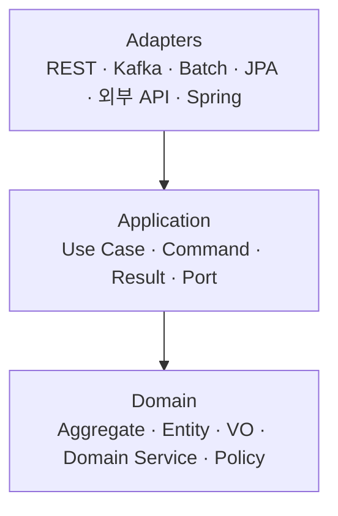
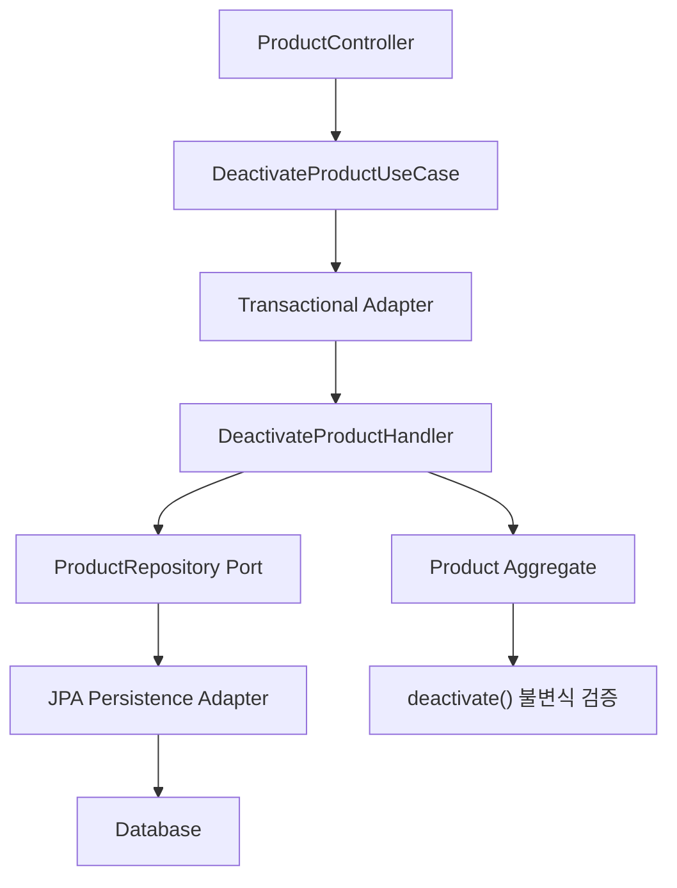
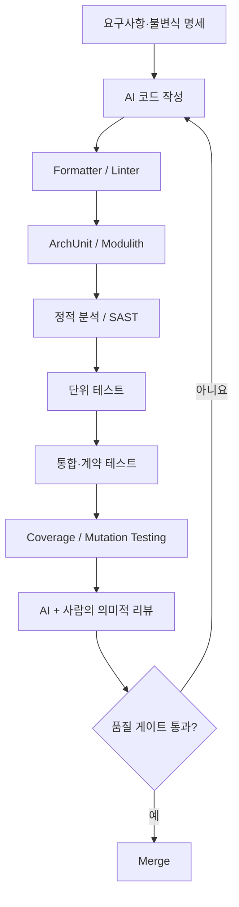

# 엔터프라이즈 백엔드 아키텍처 & 코드 컨벤션 표준

> **적용 기준:** 2026년 10월 · Java / Kotlin · Spring Boot · AI Coding Agent  
> **권장 조합:** Strict DDD + Hexagonal Architecture + Clean Architecture + 객체지향 설계 + Spring Boot + 실용적인 객체지향 생활체조

## 1. 최종 권장 아키텍처

권장하는 기준은 **Strict DDD + Hexagonal Architecture + Clean Architecture + 객체지향 설계 + Spring Boot + 실용적인 객체지향 생활체조**입니다.

**설계 원칙은 엄격하게 지키되, 실무적 가치가 부족한 형식적 제약은 강제하지 않습니다.**

엄격함의 대상은 코드의 모양이 아니라 다음과 같은 구조적 품질이어야 합니다.

- **정합성:** 도메인 불변식을 우회할 수 없는 구조
- **독립성:** 도메인과 유즈케이스가 프레임워크 및 인프라 구현에 종속되지 않는 구조
- **응집도:** 같은 변경 이유를 가진 코드가 함께 존재하는 구조
- **결합도:** 다른 도메인이나 외부 시스템의 변경이 내부로 전파되지 않는 구조
- **검증 가능성:** 아키텍처 및 코드 규칙을 CI에서 자동 강제할 수 있는 구조
- **확장성:** 장기간 기능과 데이터가 증가해도 경계를 유지하는 구조

### 권장 의존성 구조



**논리적 의존성 방향:** `Adapter → Application → Domain`. Outbound Port는 Application이 정의하고 Adapter가 구현합니다. 실행 시 호출 방향은 다를 수 있습니다.

DDD는 비즈니스 모델링 원칙, 헥사고날은 외부와의 경계 구조, 클린 아키텍처는 의존성 방향에 대한 원칙입니다. 서로 대체하는 기술이 아니므로 함께 적용할 수 있습니다.

### 규칙의 엄격도 구분

| 등급 | 적용 방식 | 대표 규칙 |
|---|---|---|
| **MUST** | CI 실패 | 의존성 역전, 순환 참조 금지, 도메인 불변식, 컨텍스트 경계, 테스트 필수 조건 |
| **SHOULD** | 기본 준수, 사유 있는 예외 허용 | 조기 반환, 불변 객체, 메서드 복잡도, 인터페이스 분리 |
| **MAY** | 상황에 따라 선택 | VO 도입, 도메인 이벤트, Factory, 별도 영속성 모델 |
| **EXCLUDE** | 강제 규칙에서 제외 | 파라미터 최대 2개, 메서드 5줄, 모든 원시 타입 포장, 모든 클래스의 인터페이스화 |

> 모든 곳에 인터페이스·VO·계층을 무조건 추가하는 것은 엄격한 설계가 아니라 과잉 설계일 수 있습니다. 반드시 지켜야 하는 것은 아키텍처 불변 조건과 책임 경계입니다.

---

## 2. 프로젝트 모듈과 패키지 구조

기본 구조는 **Bounded Context별 모듈 분리 + 모듈 내부 헥사고날 구조**를 추천합니다.

Java와 Kotlin은 동일한 논리적 구조를 사용합니다.

```text
erp/
├── build-logic/                 # 공통 Gradle 규칙
├── boot/                        # Spring Boot 실행 및 조립
├── product/                     # Product Bounded Context
├── pricing/                     # Pricing Bounded Context
├── order/                       # Order Bounded Context
├── procurement/                 # Procurement Bounded Context
├── partner/                     # Trading Partner Context
└── architecture-tests/          # 아키텍처 검증
```

각 Bounded Context 내부는 아래와 같습니다.

```text
product/
└── src/main/kotlin/com/acme/erp/product/
    ├── api/                     # 타 BC에 공개하는 계약
    │
    ├── domain/
    │   ├── model/               # Aggregate, Entity
    │   ├── vo/                  # Value Object
    │   ├── service/             # Domain Service
    │   ├── policy/              # Domain Policy
    │   ├── event/               # Domain Event
    │   └── exception/
    │
    ├── application/
    │   ├── port/
    │   │   ├── in/              # UseCase 인터페이스
    │   │   └── out/             # 외부 의존성 인터페이스
    │   ├── command/
    │   ├── result/
    │   └── usecase/             # 유즈케이스 구현
    │
    ├── adapter/
    │   ├── in/
    │   │   ├── web/             # Controller, Request, Response
    │   │   ├── message/         # Kafka Consumer
    │   │   └── batch/
    │   └── out/
    │       ├── persistence/     # JPA, QueryDSL, Mapper
    │       ├── external/        # 외부 API Client
    │       └── messaging/       # Kafka Producer
    │
    └── configuration/           # Spring Bean 조립
```

패키지는 필요할 때만 생성합니다. 예컨대 도메인 이벤트가 없다면 `domain.event` 자체가 필요 없습니다.

### 패키지·계층 의존성

| 출발 | 허용 | 금지 |
|---|---|---|
| Domain | 자기 BC의 Domain, 표준 라이브러리 | Application, Adapter, Spring, JPA |
| Application | Domain, Application 내부 | Adapter, Controller, Spring, JPA |
| Inbound Adapter | Application의 Inbound Port와 입출력 모델 | 영속성 Adapter 직접 호출 |
| Outbound Adapter | Application의 Outbound Port, Domain, 관련 기술 라이브러리 | Inbound Adapter |
| Configuration | Application, Adapter, Domain | 비즈니스 로직 구현 |
| 다른 BC | 대상 BC의 공개 `api` | 대상 BC의 내부 Domain, Repository, Adapter |

**모든 Adapter가 모든 내부 클래스에 접근할 수 있다는 뜻은 아닙니다.** Inbound Adapter는 유즈케이스 계약을 호출하고, Outbound Adapter는 자기가 구현하는 Port와 필요한 도메인 모델만 참조하도록 좁히는 것이 좋습니다.

실제로 물리적 컴파일 경계까지 강제하려면 Domain, Application, Adapter를 별도 Gradle 모듈로 나눌 수 있습니다. 다만 BC마다 무조건 네다섯 개의 Gradle 모듈을 만드는 것은 권장하지 않습니다.

기본적으로 BC별 Gradle 모듈을 만들고 ArchUnit으로 내부 계층을 검증한 뒤, **격리가 특별히 중요한 코어만 별도 컴파일 모듈로 추출**하는 방식이 좋습니다.

Spring Modulith는 모듈 간 순환 의존, 내부 패키지 접근, 허용 의존성을 검증할 수 있습니다.

---

## 3. DDD 설계 규칙

### 3.1 Bounded Context

**MUST**

1. 하나의 비즈니스 개념이 어느 BC에서 원본으로 관리되는지 명확해야 합니다.
2. 다른 BC의 Aggregate나 Repository를 직접 조작하지 않습니다.
3. 다른 BC의 내부 도메인 타입을 자신의 공개 계약에 노출하지 않습니다.
4. BC 간 데이터 참조는 식별자, 공개 API, 명시적 계약 또는 이벤트로 처리합니다.
5. BC 간 동일한 이름의 개념이 있더라도 의미와 수명주기가 다르면 독립적으로 모델링합니다.

BC가 서로 다른 배포 서비스라면 네트워크 API/메시지 계약으로 통신합니다. 같은 배포 단위라면 공개 모듈 API를 사용할 수 있습니다.

### 3.2 Aggregate Root

**MUST**

- Aggregate의 불변식은 Aggregate Root가 보호해야 합니다.
- 외부에서 내부 Entity를 직접 수정하지 않습니다.
- 컬렉션은 수정 가능한 내부 참조를 외부에 노출하지 않습니다.
- 상태 변경은 의도를 나타내는 메서드로 수행합니다.
- 다른 Aggregate는 가능한 한 식별자로 참조합니다.
- 하나의 Aggregate를 한 트랜잭션에서 일관되게 변경하도록 설계합니다.

```kotlin
class Product(
    val id: ProductId,
    status: ProductStatus
) {
    var status: ProductStatus = status
        private set

    fun deactivate() {
        check(status == ProductStatus.ACTIVE) {
            "활성 상품만 비활성화할 수 있습니다."
        }

        status = ProductStatus.INACTIVE
    }
}
```

다음 코드는 허용하지 않습니다.

```kotlin
product.status = ProductStatus.INACTIVE
```

상태 변경을 막는 이유는 단순한 캡슐화가 아닙니다. **상태 전이 규칙을 반드시 통과시키기 위해서입니다.**

Aggregate 크기는 데이터 테이블의 관계가 아니라 **동시에 유지해야 하는 비즈니스 불변식**을 기준으로 결정합니다.

### 3.3 Entity와 Value Object

| 구분 | Entity | Value Object |
|---|---|---|
| 식별성 | 식별자로 구분 | 값으로 구분 |
| 동등성 | 동일 식별자 중심 | 구성 값 중심 |
| 변경 | 규칙에 따라 상태 변경 | 기본적으로 불변 |
| 생명주기 | 존재 | 상위 모델에 귀속 |
| 예시 | Product, PurchaseOrder | Money, SkuCode, ProductId |

**VO를 도입해야 하는 경우:** 고유한 유효성 검증, 서로 다른 의미의 동일 기본 타입 구분, 단위 또는 계산 규칙, 불변식 재사용이 필요한 경우.

**VO가 필요하지 않은 경우:** 단순 전달용 문자열이거나, 포장하더라도 유의미한 규칙·의미·안전성이 추가되지 않는 경우.

Java `record`와 Kotlin `data class`, `value class`를 활용하되 모든 필드를 기계적으로 포장하지 않습니다.

### 3.4 Domain Service

Domain Service를 사용하는 기준은 **특정 Entity 또는 VO 한 개에 자연스럽게 귀속되지 않는 비즈니스 규칙**이 존재하는 경우입니다.

다만 도메인 객체의 책임을 무조건 Domain Service로 빼내면 빈약한 도메인 모델이 됩니다.

```text
Product.deactivate()        → Product 자신의 상태 전이
Money.add()                 → Money 자신의 계산
PricingPolicy.calculate()   → 가격 정책의 계산
```

비즈니스 로직을 `ProductService`라는 하나의 거대한 서비스에 전부 집어넣는 것은 금지합니다.

### 3.5 Domain Event

- 이미 발생한 비즈니스 사실을 과거형으로 표현합니다.
- 다른 Aggregate나 BC의 후속 처리가 필요한 경우 사용합니다.
- 반드시 필요하지 않다면 이벤트를 만들지 않습니다.
- 외부 발행 시에는 트랜잭션과 이벤트 저장의 원자성을 확보해야 합니다.

예를 들어 `ProductDeactivated`는 적절한 이벤트명입니다. 반면 `DeactivateProduct`는 이벤트보다는 Command에 가까운 이름입니다.

---

## 4. 헥사고날·클린 아키텍처 규칙

### Port

Port는 외부 기술을 추상화하기 위한 인터페이스이며, **사용하는 쪽의 요구를 기준으로 설계**합니다.

```java
// application.port.out
public interface ProductRepository {
    Optional<Product> findById(ProductId id);
    void save(Product product);
}
```

허용하지 않을 예시:

```java
public interface ProductRepository {
    JpaRepository<ProductJpaEntity, Long> repository();
}
```

두 번째는 Application Port가 JPA라는 기술적 세부사항을 노출합니다.

### Inbound Port

`DeactivateProductUseCase`처럼 외부 호출자가 수행할 수 있는 기능을 정의합니다.

UseCase마다 반드시 인터페이스가 있어야 하는 것은 아닙니다. 그러나 **엄격한 헥사고날 표준에서는 외부 진입점에 Inbound Port를 두는 것**을 기본값으로 삼습니다.

### Outbound Port

다음 경우에는 도입하는 것이 좋습니다.

- 데이터 영속성 접근
- 외부 API 호출
- 메시지 발행
- 파일 저장
- 현재 시간, 외부 ID 발급 등 테스트에서 제어해야 하는 비결정적 행위

단순 계산 클래스, 내부 Mapper, 구현체 하나만 존재하는 내부 헬퍼에는 불필요한 인터페이스를 만들지 않습니다.

### DTO와 모델의 분리

| 객체 | 계층 | 역할 |
|---|---|---|
| `CreateProductRequest` | Inbound Adapter | HTTP 요청 |
| `CreateProductResponse` | Inbound Adapter | HTTP 응답 |
| `CreateProductCommand` | Application | 유즈케이스 입력 |
| `CreateProductResult` | Application | 유즈케이스 출력 |
| `Product` | Domain | 비즈니스 모델 |
| `ProductJpaEntity` | Outbound Adapter | DB 매핑 |
| `ExternalProductRequest` | Outbound Adapter | 외부 API 요청 |

엄격한 표준에서는 이 객체들을 서로 혼용하지 않습니다. 다만 데이터 구조가 유사하다는 이유만으로 별도의 범용 `ProductDto`를 추가하지 않습니다.

`Request`나 `Response`라는 이름은 **유즈케이스의 HTTP 진입점과 무관한 내부 비즈니스 모델에는 사용하지 않는 것**을 기본으로 합니다.

---

## 5. 실제 구현 예시 — Kotlin/Spring Boot

엄격한 계층 분리를 유지하면서도 과도한 보일러플레이트를 만들지 않는 예시입니다.

비즈니스 기능은 **상품 비활성화**입니다.

> 가정: 상품은 `ACTIVE → INACTIVE` 상태로 전이할 수 있으며, 이미 비활성화된 상품의 중복 비활성화는 비즈니스 오류입니다. 아래 코드는 아키텍처 핵심 흐름을 보여주는 예시이므로 import, 일부 예외 변환과 테스트, 빌드 설정은 별도로 보완해야 합니다.

### 5.1 Domain — Spring 없이 구현

**`Product.kt`**

```kotlin
@JvmInline
value class ProductId(val value: UUID)

enum class ProductStatus {
    ACTIVE,
    INACTIVE
}

class Product(
    val id: ProductId,
    status: ProductStatus
) {
    var status: ProductStatus = status
        private set

    fun deactivate() {
        if (status != ProductStatus.ACTIVE) {
            throw ProductAlreadyInactiveException(id)
        }

        status = ProductStatus.INACTIVE
    }
}

class ProductAlreadyInactiveException(
    val productId: ProductId
) : RuntimeException("Product already inactive: $productId")
```

실제 프로젝트에서는 각각 별도 파일로 분리하고, `ProductId`는 `domain.vo`, `Product`는 `domain.model`에 배치합니다.

중요한 점은 `Product`가 Spring, JPA, HTTP, 데이터베이스의 존재를 모른다는 것입니다.

### 5.2 Application — 유즈케이스 계약과 구현

```kotlin
data class DeactivateProductCommand(
    val productId: ProductId
)

data class DeactivateProductResult(
    val productId: ProductId,
    val status: ProductStatus
)

// application.port.in
interface DeactivateProductUseCase {
    fun execute(
        command: DeactivateProductCommand
    ): DeactivateProductResult
}

// application.port.out
interface ProductRepository {
    fun findById(id: ProductId): Product?
    fun save(product: Product)
}

// application.usecase
class DeactivateProductHandler(
    private val products: ProductRepository
) {
    fun execute(
        command: DeactivateProductCommand
    ): DeactivateProductResult {
        val product = products.findById(command.productId)
            ?: throw ProductNotFoundException(command.productId)

        product.deactivate()
        products.save(product)

        return DeactivateProductResult(
            productId = product.id,
            status = product.status
        )
    }
}

class ProductNotFoundException(
    val productId: ProductId
) : RuntimeException("Product not found: $productId")
```

`Handler`는 Spring Bean인지 모릅니다. 비즈니스 상태 전이도 직접 구현하지 않고 Aggregate에 위임합니다.

`ProductRepository`는 **Application에서 필요한 저장 기능을 정의하는 Outbound Port**이며 Spring Data의 `JpaRepository`와 다른 개념입니다.

### 5.3 Persistence Adapter

```kotlin
@Entity
@Table(name = "products")
class ProductJpaEntity(
    @field:Id
    @field:Column(name = "public_id", nullable = false)
    var publicId: UUID,

    @field:Enumerated(EnumType.STRING)
    @field:Column(nullable = false)
    var status: ProductStatus,

    @field:Version
    var version: Long? = null
)

interface SpringDataProductRepository :
    JpaRepository<ProductJpaEntity, UUID>

@Repository
class JpaProductRepository(
    private val jpa: SpringDataProductRepository
) : ProductRepository {

    override fun findById(id: ProductId): Product? {
        return jpa.findById(id.value)
            .orElse(null)
            ?.let { entity ->
                Product(
                    id = ProductId(entity.publicId),
                    status = entity.status
                )
            }
    }

    override fun save(product: Product) {
        val entity = jpa.findById(product.id.value)
            .orElseThrow {
                ProductNotFoundException(product.id)
            }

        entity.status = product.status
        // 트랜잭션 커밋 시 JPA Dirty Checking
    }
}
```

이 예시는 변경 흐름을 보여주기 위해 단순화했습니다. 실제 구현에서는 `@Version`을 통한 낙관적 락 충돌을 테스트하고, 조회 중복 최적화 및 DB 오류를 외부 계약에 맞게 변환하는 처리도 필요합니다.

Kotlin에서는 JPA Entity를 `data class`로 정의하지 않는 것을 기본값으로 권장합니다. Entity의 식별성, 프록시, 지연 로딩, `equals/hashCode`가 충돌할 수 있기 때문입니다.

### 5.4 트랜잭션 Adapter

엄격한 클린 아키텍처에서는 Application에 `@Transactional`을 추가하지 않는 편이 경계를 더 명확하게 만듭니다.

따라서 트랜잭션을 Spring Adapter에서 관리할 수 있습니다.

```kotlin
@Service
class DeactivateProductTxAdapter(
    private val handler: DeactivateProductHandler
) : DeactivateProductUseCase {

    @Transactional
    override fun execute(
        command: DeactivateProductCommand
    ): DeactivateProductResult {
        return handler.execute(command)
    }
}

@Configuration
class ProductConfiguration {

    @Bean
    fun deactivateProductHandler(
        repository: ProductRepository
    ): DeactivateProductHandler {
        return DeactivateProductHandler(repository)
    }
}
```

이렇게 하면 Application은 Spring에 대한 의존성이 완전히 사라집니다.

다만 이 Adapter는 트랜잭션이라는 기술적 경계를 구현하기 위한 추가 비용입니다. **독립적인 코어 유지가 가장 높은 우선순위일 때 채택**하고, 복잡도에 비해 이득이 작다면 Application 서비스의 `@Transactional`을 허용하는 완화된 정책도 가능합니다.

Spring의 프록시 기반 트랜잭션은 자기 자신의 메서드를 내부 호출할 때 프록시를 거치지 않는다는 제약이 있습니다. 따라서 호출 경계 테스트가 중요합니다.

### 5.5 Inbound Web Adapter

```kotlin
data class DeactivateProductResponse(
    val productId: UUID,
    val status: String
)

@RestController
@RequestMapping("/api/products")
class ProductController(
    private val deactivateProduct: DeactivateProductUseCase
) {
    @PatchMapping("/{id}/deactivation")
    fun deactivate(
        @PathVariable id: UUID
    ): DeactivateProductResponse {
        val result = deactivateProduct.execute(
            DeactivateProductCommand(ProductId(id))
        )

        return DeactivateProductResponse(
            productId = result.productId.value,
            status = result.status.name
        )
    }
}
```

다음의 처리는 HTTP 계층에서 추가로 구현합니다.

- `ProductNotFoundException` → HTTP 404
- `ProductAlreadyInactiveException` → HTTP 409
- 낙관적 락 충돌 → HTTP 409 또는 정책에 따른 재시도
- 예상하지 못한 예외 → HTTP 500, 내부 정보 노출 금지

중복 요청을 멱등한 성공으로 처리해야 하는 API라면 도메인 전이 규칙부터 다르게 정의해야 합니다.

**전체 실행 흐름**



### 5.6 Java에서도 동일한 원칙 사용

Java는 `record`, 생성자 주입, 불변 필드 등을 활용합니다.

```java
public record ProductId(UUID value) {
    public ProductId {
        Objects.requireNonNull(value);
    }
}

public record DeactivateProductCommand(
    ProductId productId
) {}

public final class Product {

    private final ProductId id;
    private ProductStatus status;

    public Product(ProductId id, ProductStatus status) {
        this.id = Objects.requireNonNull(id);
        this.status = Objects.requireNonNull(status);
    }

    public void deactivate() {
        if (status != ProductStatus.ACTIVE) {
            throw new ProductAlreadyInactiveException(id);
        }
        status = ProductStatus.INACTIVE;
    }

    public ProductId id() {
        return id;
    }

    public ProductStatus status() {
        return status;
    }
}
```

Java와 Kotlin의 **아키텍처 경계는 같고, 언어 기능을 활용하는 코드 컨벤션만 다르게** 설정해야 합니다.

---

## 6. 객체지향 설계 원칙

SOLID 전체를 그대로 기계적 검증 대상으로 삼지는 않습니다. 원칙의 취지를 지키되 실제로 위반 여부를 판단할 수 있게 정의합니다.

| 원칙 | 엄격한 실무 규칙 |
|---|---|
| SRP | 하나의 클래스는 하나의 응집된 책임과 변경 이유를 가진다 |
| OCP | 안정된 도메인 코어의 변경 없이 외부 구현을 교체할 수 있는 확장 지점을 설계한다 |
| LSP | 구현체를 교체해도 인터페이스의 사전·사후조건을 위반하지 않는다 |
| ISP | 사용자가 필요하지 않은 기능까지 강제로 의존하지 않도록 계약을 분리한다 |
| DIP | 핵심 정책은 외부 구현에 의존하지 않고, 경계 인터페이스가 내부에 위치하도록 한다 |

### 추가로 강제할 객체지향 규칙

| 규칙 | 등급 | 실무 해석 |
|---|---|---|
| 필드 캡슐화 | MUST | 도메인 상태를 외부에서 임의 수정할 수 없음 |
| 불변식 보호 | MUST | 생성자와 상태 전이 모두 검증 |
| 상속보다 합성 | SHOULD | 상속은 실제 다형성과 대체 가능성이 있을 때 사용 |
| 불변 객체 우선 | SHOULD | VO, Command, Result 등은 기본적으로 불변 |
| 명시적 상태 전이 | MUST | `setStatus()`보다 `activate()`, `deactivate()` |
| Tell, Don't Ask | SHOULD | 상태를 꺼내 판단하기보다 객체에 행위를 요청 |
| Law of Demeter | SHOULD | 외부 객체의 내부 구조를 연쇄적으로 탐색하지 않음 |
| 다형성 | SHOULD | 실제 변형 지점에 적용, 단순 `if`를 없애려고 인터페이스를 만들지 않음 |
| Null 관리 | MUST | Null을 허용하는 의미와 경계를 명시 |
| 예외 타입의 의미 | MUST | 정상 흐름의 분기와 비정상 실패를 구분 |

**Getter를 모두 금지하지 않습니다.** 객체의 정보를 조회하는 것은 정상적인 책임입니다. 금지 대상은 외부 코드가 내부 상태를 가져와 도메인 규칙을 대신 수행하는 구조입니다.

---

## 7. 객체지향 생활체조 9원칙 — 실무 적용 기준

Object Calisthenics를 그대로 적용하면 실무적으로 불편해지는 규칙이 많습니다.

다음과 같이 재정의하는 것을 권장합니다.

| 원칙 | 적용 | 조정된 규칙 |
|---|---|---|
| 1. 한 메서드에 한 단계의 들여쓰기 | 조건부 | 복잡한 중첩을 억제하되 2~3단계 허용 |
| 2. `else` 사용 금지 | 조건부 | Guard Clause와 Early Return 우선 |
| 3. 모든 원시 타입 포장 | 제외 | 비즈니스 불변식 또는 의미가 있을 때만 VO |
| 4. 일급 컬렉션 사용 | 조건부 | 컬렉션 자체에 비즈니스 규칙이 있을 때 적용 |
| 5. 한 줄에 점 하나만 사용 | 제외 | 디미터 법칙을 취지만 적용 |
| 6. 축약어 사용 금지 | 적용 | 의미 없는 축약어 금지, 업계 표준 용어 허용 |
| 7. 모든 엔티티를 작게 유지 | 조건부 | 코드 길이가 아니라 응집도와 책임으로 판단 |
| 8. 인스턴스 변수 2개 이하 | 제외 | 의미 있는 상태를 임의로 쪼개지 않음 |
| 9. Getter/Setter 사용 금지 | 부분 적용 | 무분별한 Setter 금지, 조회용 Getter 허용 |

특히 다음 규칙들은 **강제하지 않는 편이 낫습니다.**

- 메서드 파라미터 2개 이하
- 메서드 5줄 이하
- 클래스 50줄 이하
- 인스턴스 필드 2개 이하
- 모든 원시 타입에 VO 적용
- 모든 `else` 제거
- 모든 Getter 제거
- 모든 체이닝 제거

단, **인지 복잡도가 높은 메서드와 과도하게 많은 파라미터는 품질 경고 대상**으로 지정할 수 있습니다.

파라미터가 많다는 사실만으로 객체를 만들지 않습니다. 여러 값이 하나의 비즈니스 입력을 구성할 때 `Command`나 의미 있는 VO로 묶어야 합니다.

---

## 8. Spring Boot 코드 컨벤션

| 구분 | 규칙 | 등급 |
|---|---|---|
| DI | 생성자 주입 사용 | MUST |
| Field Injection | `@Autowired` 필드 주입 금지 | MUST |
| Controller | HTTP 요청 처리·검증·변환만 수행 | MUST |
| Domain | Spring Annotation 사용 금지 | MUST |
| Application | 엄격한 모드에서 Spring 의존 금지 | MUST |
| Transaction | 유즈케이스 실행 경계에서 관리 | MUST |
| Transaction 범위 | 원격 HTTP 호출·장시간 작업을 DB 트랜잭션 내부에서 실행하지 않음 | SHOULD |
| Self Invocation | 프록시 기반 `@Transactional` 자기 호출에 의존하지 않음 | MUST |
| JPA Entity | API 응답에 직접 노출 금지 | MUST |
| Lazy Loading | Controller에서 지연 로딩에 의존 금지 | MUST |
| OSIV | 백엔드 API 기본 비활성화 | SHOULD |
| Repository | Controller에서 직접 호출 금지 | MUST |
| 예외 | `@RestControllerAdvice`를 통한 일관된 오류 응답 | MUST |
| Logging | 비밀번호·토큰·개인정보 등 민감정보 기록 금지 | MUST |

설정 예시:

```yaml
spring:
  jpa:
    open-in-view: false
```

### 트랜잭션 처리 추가 규칙

`@Transactional(readOnly = true)`는 읽기 전용 의도를 나타내지만, 모든 환경에서 쓰기를 물리적으로 차단하는 보안 장치는 아닙니다.

동시성 정합성이 중요한 Aggregate에는 낙관적 락 또는 필요한 경우 비관적 락을 적용합니다. DB의 고유 제약조건과 참조 제약조건도 반드시 활용합니다.

Spring은 기본적으로 `RuntimeException`과 `Error`에 롤백을 적용하고, 체크 예외에는 기본 롤백을 적용하지 않습니다. Kotlin에서는 체크 예외가 강제되지 않으므로 전체 예외 롤백 정책을 별도로 검토하는 것이 좋습니다.

---

## 9. Java·Kotlin 언어별 컨벤션

| 주제 | Java | Kotlin |
|---|---|---|
| 불변 DTO | `record` 우선 | `data class`와 `val` 우선 |
| 식별자 VO | `record ProductId` | `@JvmInline value class ProductId` |
| Null 반환 | `Optional`을 적절히 사용 | Nullable 타입 `?` |
| 상태 모델 | `enum`, `sealed interface` | `enum`, `sealed interface` |
| 상속 | 불필요한 상속 제한 | 기본 `final` 유지 |
| 예외 | 의미 있는 RuntimeException | 의미 있는 Exception 또는 Result 모델 |
| DI | 생성자 주입 | 주 생성자 주입 |
| JPA Entity | 일반 클래스 | 일반 클래스, compiler plugin 검토 |
| 포맷팅 | Spotless + google-java-format | ktlint |
| 정적 분석 | PMD, SpotBugs 등 | detekt |

### Kotlin 추가 MUST 규칙

- Domain과 Application에서 `!!` 사용 금지
- Domain과 Application에서 `lateinit` 사용 금지
- 불변 데이터는 `var`보다 `val` 우선
- 공개 API의 반환 타입을 명시
- 부수효과가 있는 Extension Function으로 비즈니스 규칙을 숨기지 않음
- Kotlin `data class`를 JPA Entity에 기본 적용하지 않음
- `suspend`나 Coroutine을 동기 JPA 트랜잭션과 혼용할 때 실행 컨텍스트 및 트랜잭션 전파를 검증

Kotlin/Spring에서는 `kotlin-spring` 컴파일러 플러그인으로 Spring Bean의 프록시 요구사항을 지원할 수 있습니다. JPA에서는 `kotlin-jpa`의 no-arg 생성자 지원을 이용하고, 엔티티 프록시를 위한 open 설정도 별도로 검토해야 합니다.

---

## 10. 정적 분석으로 강제할 아키텍처 규칙

AI 에이전트가 코드를 주로 작성한다면 이 부분이 가장 중요합니다.

### ArchUnit 아키텍처 테스트

다음 테스트는 Java와 Kotlin의 컴파일된 JVM 바이트코드를 대상으로 적용할 수 있습니다.

```java
@AnalyzeClasses(
    packages = "com.acme.erp",
    importOptions = ImportOption.DoNotIncludeTests.class
)
class ArchitectureTest {

    @ArchTest
    static final ArchRule domainMustBeIndependent =
        noClasses()
            .that().resideInAPackage("..domain..")
            .should().dependOnClassesThat()
            .resideInAnyPackage(
                "..application..",
                "..adapter..",
                "..configuration..",
                "org.springframework..",
                "jakarta.persistence.."
            );

    @ArchTest
    static final ArchRule applicationMustBeIndependent =
        noClasses()
            .that().resideInAPackage("..application..")
            .should().dependOnClassesThat()
            .resideInAnyPackage(
                "..adapter..",
                "..configuration..",
                "org.springframework..",
                "jakarta.persistence.."
            );

    @ArchTest
    static final ArchRule adaptersMustNotCross =
        noClasses()
            .that().resideInAPackage("..adapter.in..")
            .should().dependOnClassesThat()
            .resideInAPackage("..adapter.out..");

    @ArchTest
    static final ArchRule modulesMustNotBeCyclic =
        slices()
            .matching("com.acme.erp.(*)..")
            .should().beFreeOfCycles();
}
```

예시에 필요한 ArchUnit의 정적 import와 JUnit 의존성은 생략했습니다. 이 규칙만으로 BC 간 공개 API 접근 정책까지 모두 검증되는 것은 아니므로 다음 검사를 추가합니다.

### Spring Modulith 모듈 경계 테스트

```kotlin
class ModuleArchitectureTest {

    @Test
    fun `모듈 경계를 위반하지 않는다`() {
        ApplicationModules.of(
            ErpApplication::class.java
        ).verify()
    }
}
```

이는 모듈 간 순환 의존, 내부 패키지 침범, 선언된 허용 의존성 등을 검증합니다. 정확한 탐지 범위는 프로젝트의 모듈 정의 설정에 따라 달라집니다.

### 도구별 책임

| 도구 | 역할 |
|---|---|
| ArchUnit | 의존성 방향, 순환 참조, 계층 경계 |
| Spring Modulith | BC에 대응하는 애플리케이션 모듈 경계 |
| Checkstyle | Java 네이밍·스타일 규칙 |
| PMD | 코드 구조, 복잡도, 잠재적 문제 |
| SpotBugs | Java 바이트코드 기반 버그 패턴 |
| detekt | Kotlin 코드 품질·복잡도 |
| ktlint | Kotlin 코드 포맷팅 |
| Semgrep | 프로젝트 전용 정적 검사 규칙 |
| OpenRewrite | 규칙 기반 코드 변환·마이그레이션 |
| PIT | Mutation Testing |

**정적 분석은 책임 경계 위반을 찾을 수 있지만, 비즈니스 규칙이 올바르게 구현되었는지 자체를 완전히 증명하지는 못합니다.**

예컨대 `@Transactional` 존재 여부는 검사할 수 있지만, 해당 트랜잭션이 비즈니스 전체에서 올바른 원자성 경계인지 자동으로 확정하기는 어렵습니다.

---

## 11. 테스트·AI 개발 품질 게이트



테스트 코드 역시 AI가 작성한 결과이므로 테스트 통과만으로 충분하지 않습니다.

각 유즈케이스의 테스트 명세에는 다음 조건을 포함해야 합니다.

| 검증 유형 | 예시 | 권장 |
|---|---|---|
| 정상 동작 | 활성 상품 비활성화 성공 | 필수 |
| 상태 전이 위반 | 이미 비활성화된 상품 재처리 | 필수 |
| 입력 경계값 | 빈 값, 최대 길이, 수량 0 | 해당 시 필수 |
| 데이터 미존재 | 없는 상품 식별자 | 필수 |
| 동시성 | 같은 상품 동시 변경 | 상태 변경 시 필수 |
| DB 제약 | 유일성, FK, 낙관적 락 | 관련 기능 필수 |
| 트랜잭션 | 중간 실패 시 롤백 | 쓰기 유즈케이스 필수 |
| 외부 계약 | 타 시스템 오류·응답 변경 | 외부 연동 시 필수 |
| 멱등성 | 중복 메시지·요청 | 중복 가능 호출 시 필수 |
| 보안 | 권한 없는 사용자 요청 | 보호된 기능 필수 |

테스트 커버리지 100%를 무조건 강제하기보다는 **변경된 핵심 도메인 로직의 분기 검증과 주요 Mutation 생존 여부**를 품질 게이트로 활용하는 것이 좋습니다.

Mutation Testing 역시 누락된 요구사항이나 잘못된 기대값을 완전히 발견하지 못하므로, 요구사항에서 독립적으로 도출한 테스트 케이스와 함께 사용해야 합니다.

---

## 12. AI Coding Agent에 전달할 AGENTS.md

다음과 같은 프로젝트 규칙 문서를 권장합니다.

```markdown
# Architecture & Coding Rules

## Architecture
- Follow DDD, Hexagonal and Clean Architecture.
- Organize source code by Bounded Context.
- Domain must not depend on Application, Adapter or Spring.
- Application must not depend on infrastructure.
- Access other modules through public APIs only.
- Never introduce cyclic dependencies.

## Domain
- Protect all Aggregate invariants.
- Do not expose mutable domain state.
- Use intention-revealing behavior methods.
- Reference other aggregates by identity.
- Create Value Objects when they enforce meaningful rules.

## Application
- Keep one clear responsibility per use case.
- Define outbound ports from consumer needs.
- Use Command for use-case inputs.
- Use Result for use-case outputs.
- Do not leak HTTP/JPA types into application contracts.

## Adapters
- Request and Response belong to transport boundaries.
- JPA entities must not be returned from controllers.
- Translate external errors at their boundaries.
- Preserve transaction and concurrency semantics.

## Code Quality
- Prefer immutable objects.
- Prefer constructor injection.
- Avoid unnecessary interfaces and wrappers.
- Do not enforce a maximum of two parameters.
- Do not enforce arbitrary method or class line counts.
- Prefer early returns over deep nesting.
- Avoid hidden side effects.

## Verification
- Run formatting and static analysis.
- Run architecture tests.
- Run unit and integration tests.
- Check negative and boundary cases.
- Verify concurrency and rollback where relevant.
- Never modify tests solely to make failing code pass.
- Report unverified behavior before submitting changes.
```

AI 개발 절차에서는 규칙 파일을 읽는 것보다 **규칙 위반 시 실제로 빌드를 실패시키는 것**이 중요합니다.

---

## 13. 최종적으로 적용할 표준

| 영역 | 최종 선택 |
|---|---|
| 프로젝트 경계 | DDD Bounded Context |
| 비즈니스 모델 | Rich Domain Model |
| 도메인 정합성 | Aggregate / VO / Invariant |
| 애플리케이션 구성 | UseCase 중심 |
| 기술 경계 | Strict Hexagonal |
| 의존성 방향 | Clean Architecture |
| 배포 구조 | 기본은 Modular Monolith, 필요 시 MSA |
| 객체지향 | SOLID + 캡슐화 + 합성 우선 |
| 생활체조 | 실용 규칙만 선택 적용 |
| 언어 | Java / Kotlin 모두 지원 |
| 프레임워크 | Spring Boot |
| 영속성 | 엄격한 모드에서는 Domain / JPA 모델 분리 |
| 정적 분석 | ArchUnit + Modulith + 언어별 Linter |
| 테스트 | 단위·통합·계약·Mutation Testing |
| AI 개발 | AGENTS.md + 요구사항 명세 + 자동 품질 게이트 |

### 최종 판단

**가장 엄격한 실무 표준은 코드의 모든 모양을 제한하는 것이 아니라, 변경해도 안 되는 경계와 보장해야 하는 불변식을 강제하는 것입니다.**

따라서 헥사고날·클린 아키텍처·DDD는 강하게 적용하되, 객체지향 생활체조의 수치 중심 규칙은 선택적으로 적용하는 구성이 적절합니다.

특히 AI Native 환경이라면 **패키지 의존성, 도메인 캡슐화, 트랜잭션 경계, 모듈 공개 계약, 테스트 검증 수준**을 최우선으로 강제하는 표준을 추천합니다.

---

## 참고 공식 문서

- [Spring Framework — Declarative Transaction Management](https://docs.spring.io/spring-framework/reference/data-access/transaction/declarative.html)
- [Spring Modulith — Reference Documentation](https://docs.spring.io/spring-modulith/reference/)
- [ArchUnit — User Guide](https://www.archunit.org/userguide/html/000_Index.html)
- [Kotlin — Spring Compiler Plugin](https://kotlinlang.org/docs/all-open-plugin.html#spring-support)
- [Kotlin — No-arg Compiler Plugin](https://kotlinlang.org/docs/no-arg-plugin.html)
- [Kotlin — JPA Integration](https://kotlinlang.org/docs/no-arg-plugin.html#jpa-support)

> **문서 성격:** 앞선 답변을 마크다운 형식으로 정리한 아키텍처·코드 컨벤션 가이드입니다. 예제 코드는 설명용이며, 빌드 가능한 전체 프로젝트 템플릿은 아닙니다.
